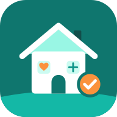
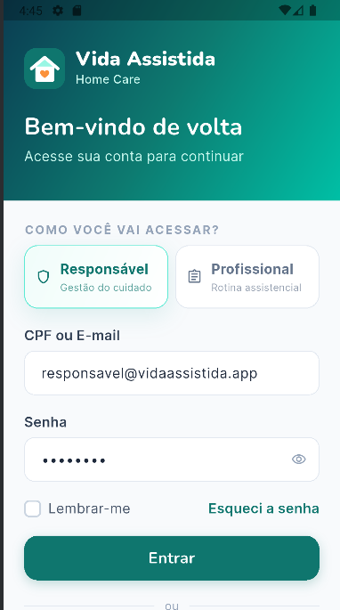
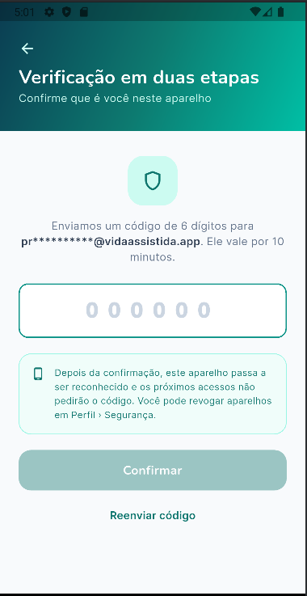
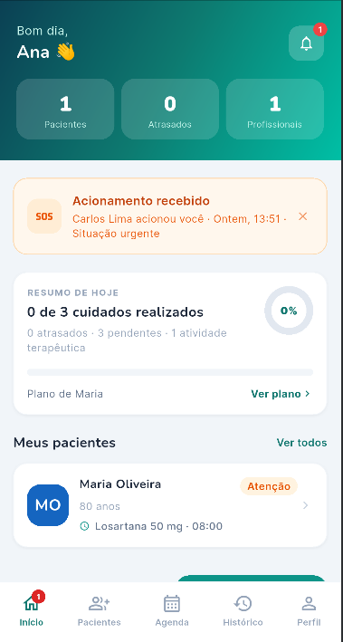
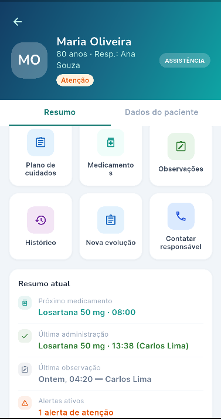
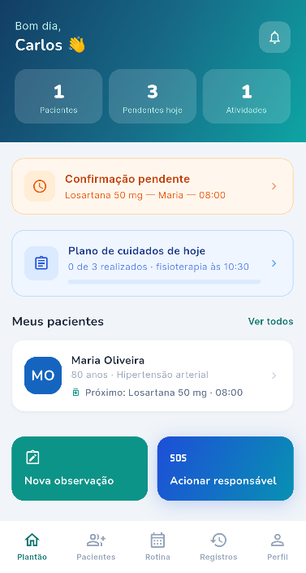
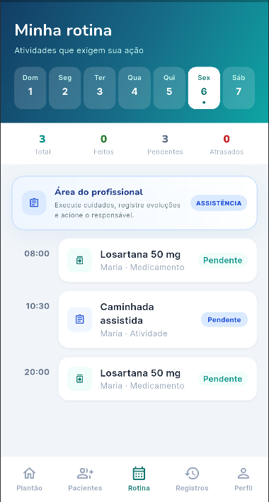
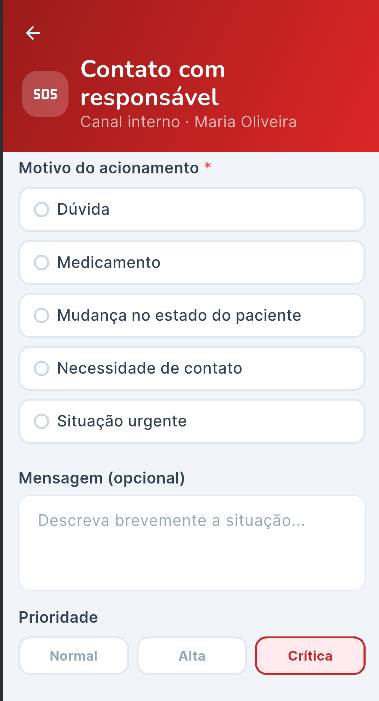
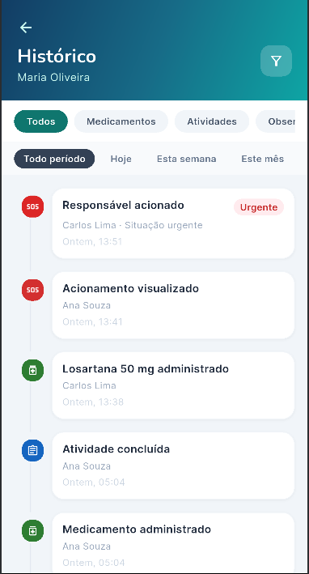
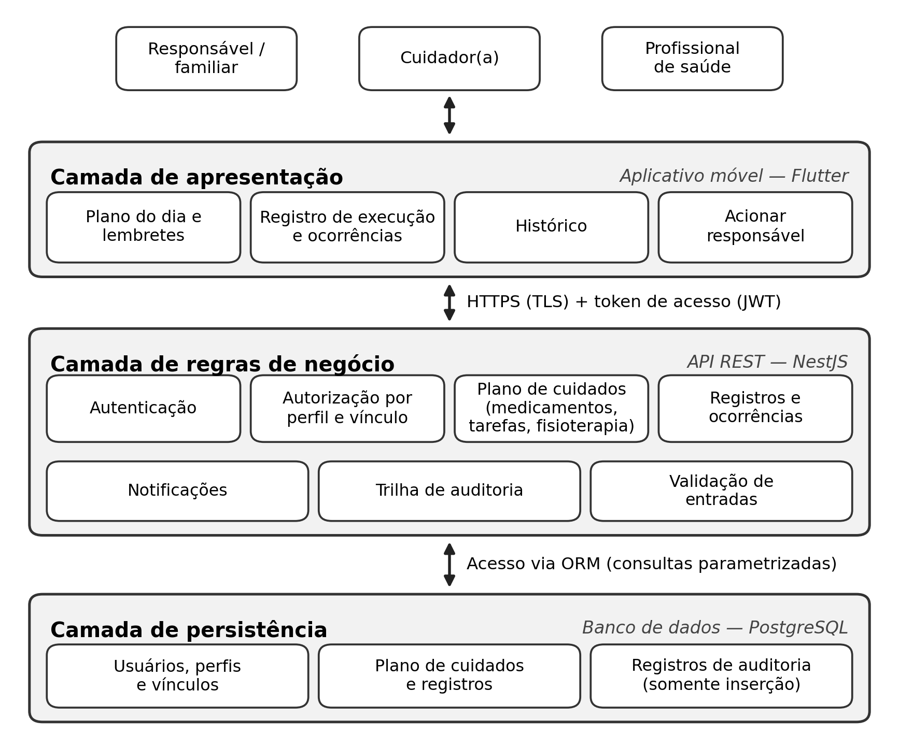

<p align="center">
  
</p>

<h1 align="center">Vida Assistida</h1>

<p align="center">
  Aplicação móvel para apoio à coordenação e à rastreabilidade do plano de cuidados na atenção domiciliar
</p>

<p align="center">
  <a href="https://tcc.atmserv.cloud"><strong>Demonstração online</strong></a> ·
  <a href="#como-executar">Como executar</a> ·
  <a href="#licença">Licença</a>
</p>

---

## Sobre o projeto

Trabalho de Conclusão de Curso (TCC) do curso de **Ciência da Computação** da **Universidade Tiradentes (UNIT)**, Aracaju – SE, 2026.

- **Autor:** Davi Rocha dos Santos
- **Orientadora:** Prof.ª Layse Santos Souza
- **Artigo:** *Vida Assistida: uma Aplicação Móvel para Apoio à Coordenação e à Rastreabilidade do Plano de Cuidados na Atenção Domiciliar*

Na atenção domiciliar, informações sobre medicamentos, exercícios e intercorrências costumam circular por ligações, mensagens e anotações em papel. O Vida Assistida reúne, em um só aplicativo para **responsáveis, cuidadores e profissionais de saúde**, o plano de cuidados, a confirmação de cada atividade, o histórico com autoria e o controle de acesso por perfil.

> Protótipo acadêmico. Não substitui serviços de emergência, prontuários oficiais, avaliação clínica ou prescrição de profissional habilitado. Todos os dados de demonstração são fictícios.

## Telas

| Login | Verificação 2FA | Início do responsável | Resumo do paciente |
| :---: | :---: | :---: | :---: |
|  |  |  |  |
| **Início do profissional** | **Rotina** | **Acionar responsável** | **Histórico** |
|  |  |  |  |

## Funcionalidades

- **Perfis e vínculos:** o responsável cadastra o paciente e convida profissionais por código (válido por 7 dias), inspirado no modelo de turmas do Google Classroom.
- **Permissões por profissional:** ver e registrar medicamentos, gerenciar o plano, registrar atividades e observações, ver o histórico e editar o paciente; o acesso pode ser suspenso ou removido.
- **Medicamentos:** agenda por horário, lembretes no celular (sem o nome do medicamento na tela bloqueada) e confirmação ou justificativa da administração.
- **Plano de cuidados:** atividades terapêuticas com registro de execução.
- **Observações e intercorrências:** categoria, nível de atenção e opção de notificar o responsável.
- **Acionamento do responsável:** motivo, prioridade e toque contínuo de 2 segundos para evitar disparos acidentais.
- **Histórico auditável:** cada ação registrada com autor, data e hora, com filtros por tipo e período.
- **Segurança:** autenticação em dois fatores (2FA), senha com hash bcrypt, token JWT de 1 hora, limitação de tentativas e validação das entradas.

## Arquitetura e tecnologias

<p align="center"></p>

| Camada | Tecnologia |
| --- | --- |
| Aplicativo | Flutter (Dart) para Android e web |
| API | NestJS (TypeScript), padrão REST, documentação Swagger |
| Banco de dados | PostgreSQL com TypeORM e migrations |
| Ambiente | Docker Compose |
| Testes | Jest (API) e flutter_test (aplicativo) |
| Segurança | OWASP MASVS (aplicativo) e OWASP ASVS (API), LGPD |

## Estrutura do repositório

```
.
├── api/                 # API REST em NestJS
│   ├── src/             # módulos: auth, patients, medications, care, observations,
│   │                    # emergency, notifications, audit, users, mail
│   └── .env.example     # modelo de configuração (copie para .env)
├── mobile/              # aplicativo Flutter
│   ├── lib/             # telas, núcleo (API, sessão, modo demonstração) e widgets
│   ├── assets/brand/    # logo e ícones
│   └── test/            # testes do aplicativo
├── docs/                # imagens usadas neste README
├── docker-compose.yml   # PostgreSQL e Adminer para desenvolvimento
├── MODO_DEMO.md         # guia do modo de demonstração
└── LICENSE
```

## Como executar

### Pré-requisitos

- [Docker](https://www.docker.com/) e Docker Compose
- [Node.js](https://nodejs.org/) 20 ou superior
- [Flutter](https://flutter.dev/) 3.x

### 1. Banco de dados e API

```powershell
docker compose up -d
Copy-Item api/.env.example api/.env   # no Linux/macOS: cp api/.env.example api/.env
Set-Location api
npm install
npm run start:dev
```

- API: `http://localhost:3000/api/v1`
- Swagger: `http://localhost:3000/docs`
- O PostgreSQL usa a porta `5433` para não conflitar com instalações locais.

Antes de usar fora do ambiente local, troque `JWT_SECRET` e as senhas do banco no `.env`. As senhas do `docker-compose.yml` e do `.env.example` servem apenas para desenvolvimento.

Com `SEED_DEMO=true`, a API cria dados fictícios e estas contas:

| Perfil | E-mail | Senha |
| --- | --- | --- |
| Responsável | `responsavel@vidaassistida.app` | `Demo@123` |
| Profissional | `profissional@vidaassistida.app` | `Demo@123` |

O código de convite do paciente de demonstração é `VIDA2026`.

### 2. Aplicativo Flutter

Em outro terminal:

```powershell
Set-Location mobile
flutter pub get
flutter run -d chrome
```

No navegador, o app usa `http://localhost:3000/api/v1`; no emulador Android, `http://10.0.2.2:3000/api/v1`. Para outro endereço:

```powershell
flutter run --dart-define=API_URL=http://SEU_IP:3000/api/v1
```

### 3. Modo demonstração (sem API)

Usado no teste de usabilidade: o app roda com um servidor simulado em memória e dados fictícios, sem banco e sem cadastro. O código de verificação em duas etapas é `123456`.

```powershell
Set-Location mobile
flutter run -d chrome --dart-define=DEMO=true
```

Detalhes e opções de publicação em [MODO_DEMO.md](MODO_DEMO.md).

### E-mail (opcional)

Para enviar o código de verificação e o link de redefinição de senha por e-mail, configure `SMTP_HOST`, `SMTP_PORT`, `SMTP_USER`, `SMTP_PASS` e `MAIL_FROM` no `api/.env`. Sem SMTP, os códigos aparecem no log da API (somente fora de produção).

## Testes

```powershell
# API (Jest): regras de negócio, requisitos (R01–R12) e segurança (S01–S13)
Set-Location api
npm test

# Aplicativo (flutter_test)
Set-Location ../mobile
flutter test
```

Resultados descritos no artigo: 47 testes automatizados aprovados. No teste de usabilidade com 10 participantes, 100% das tarefas foram concluídas sem ajuda e a média na System Usability Scale (SUS) foi 88,3.

## Decisões de segurança

- senhas armazenadas com hash bcrypt;
- autenticação em dois fatores: aparelho confiável assina um desafio com chave Ed25519; aparelho novo recebe código de 6 dígitos por e-mail (10 minutos, 5 tentativas); aparelhos podem ser revogados em Perfil › Segurança;
- o perfil vem do usuário autenticado, não de um seletor no login;
- o servidor valida o vínculo e as permissões em todas as operações;
- DTOs recusam campos desconhecidos e há limitação de requisições no login;
- ações relevantes produzem registros de auditoria;
- `synchronize` desativado: alterações de esquema usam migrations.

O botão de acionamento registra e destaca um alerta para o responsável dentro do sistema; ele não liga para serviços públicos de emergência.

## Licença

Distribuído sob a licença MIT. Veja [LICENSE](LICENSE).
